# PlantGen

A Blender add-on for procedural plants, inspired by SpeedTree and Natsura,
focused on **perennials** (grasses and small perennials). Targets
**Blender 5.2 LTS+**.

[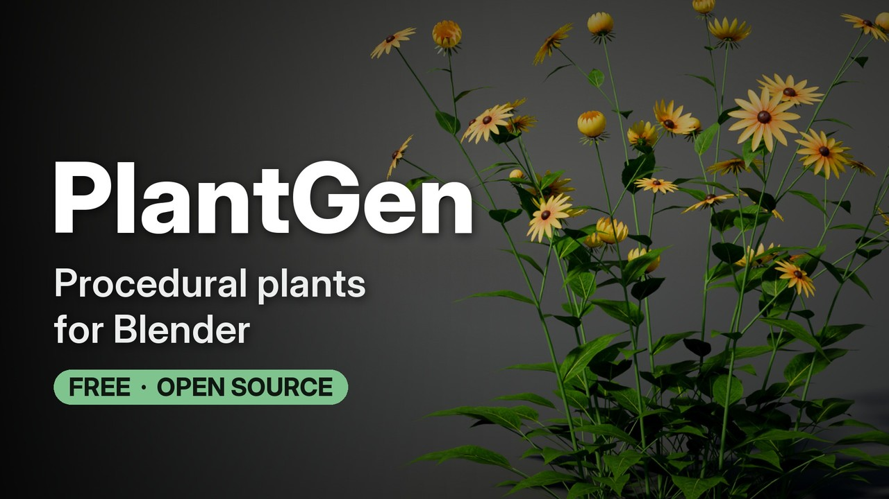](https://youtu.be/aZQsERks7lU)

**[Watch the trailer on YouTube](https://youtu.be/aZQsERks7lU)** (2:21)

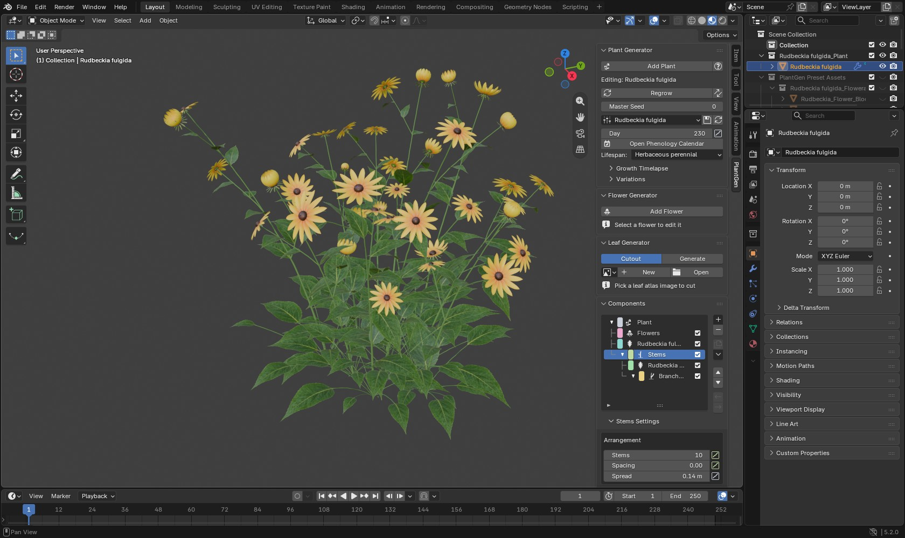

Plants are **grown, not drawn**: a developmental phytomer simulation builds
the skeleton step by step (a level stack of stems and branches, phyllotaxis,
inflorescences, a phenological calendar), a physics pass shapes it (gravity,
tropisms, pipe-model widths), and one Geometry Nodes modifier turns it into a
welded, UV'd stem mesh with instanced leaves, flowers, buds and fruit. Two
asset tools live in the same add-on: the **Leaf Generator** and the
**Flower Generator (FlowerGen)**, which the plant's leaf and flower components
draw from.

The artist manual ships with the add-on and opens from Plant Generator's help
button ([`plant_gen/docs/plantgen-docs.html`](plant_gen/docs/plantgen-docs.html)).

## Bundled presets
Eight species, each researched against the real plant. Rendered as they come, in
Cycles.

| | | | |
|:---:|:---:|:---:|:---:|
| 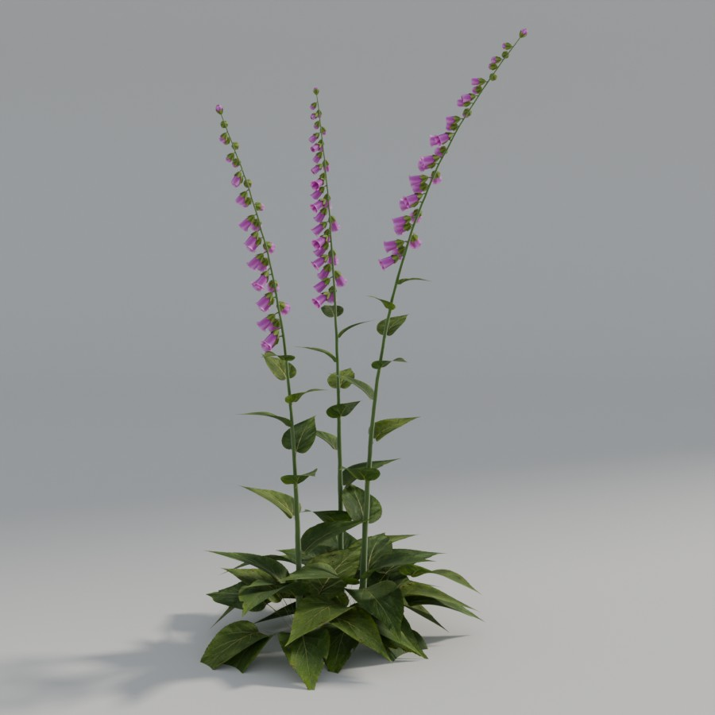 | 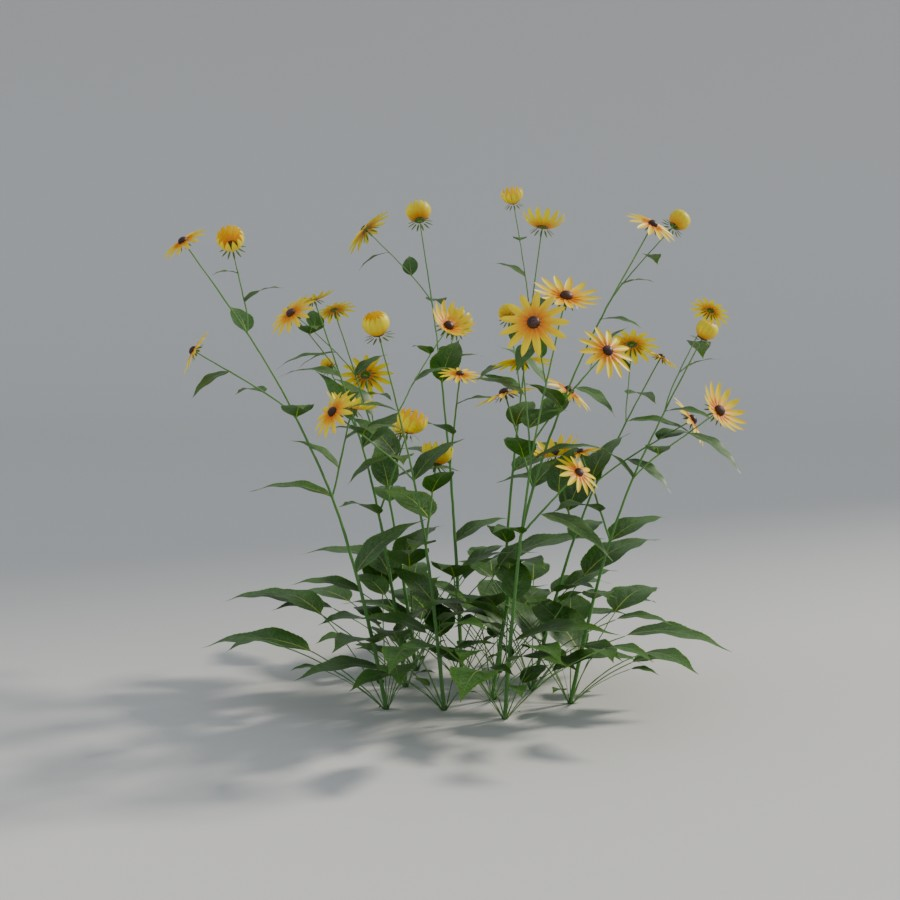 | 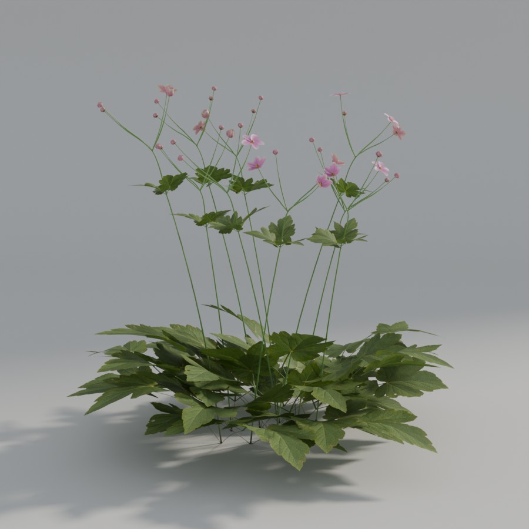 | 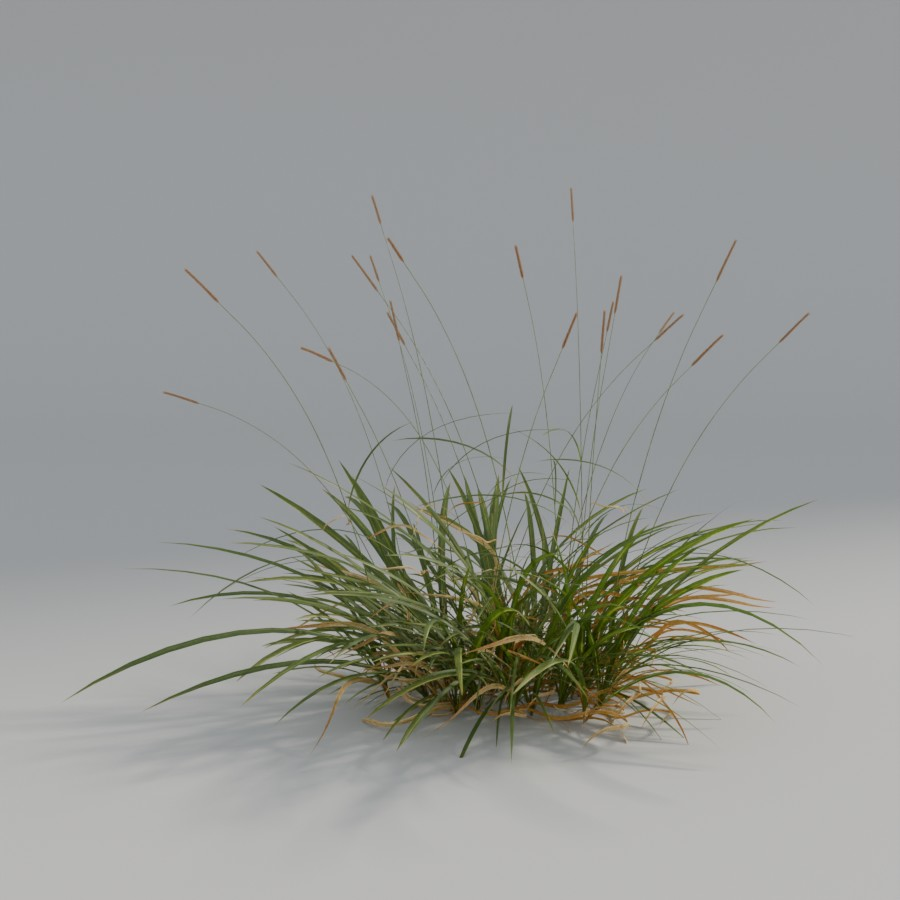 |
| *Digitalis purpurea* | *Rudbeckia fulgida* | *Anemone hupehensis* | *Alopecurus pratensis* |
| 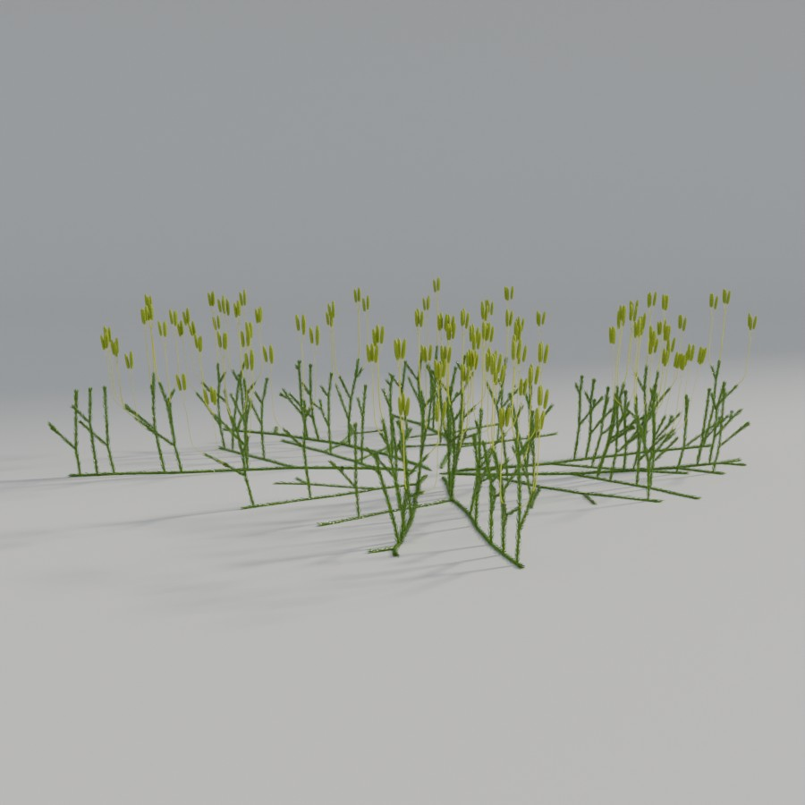 | 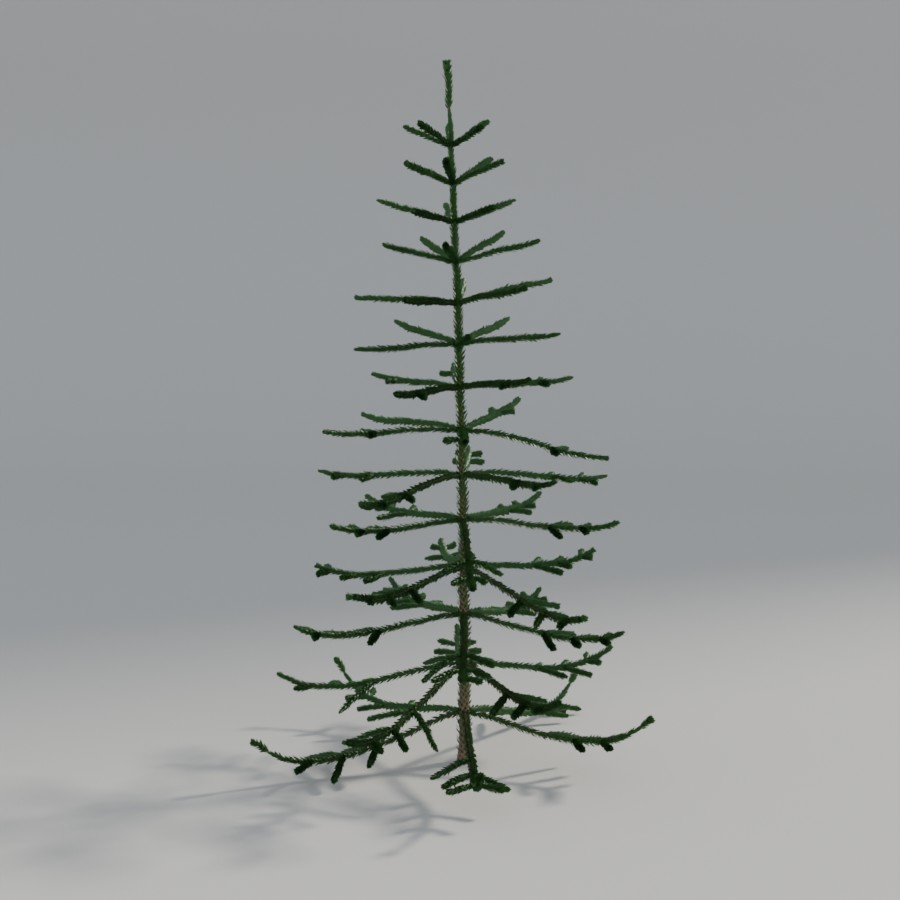 | 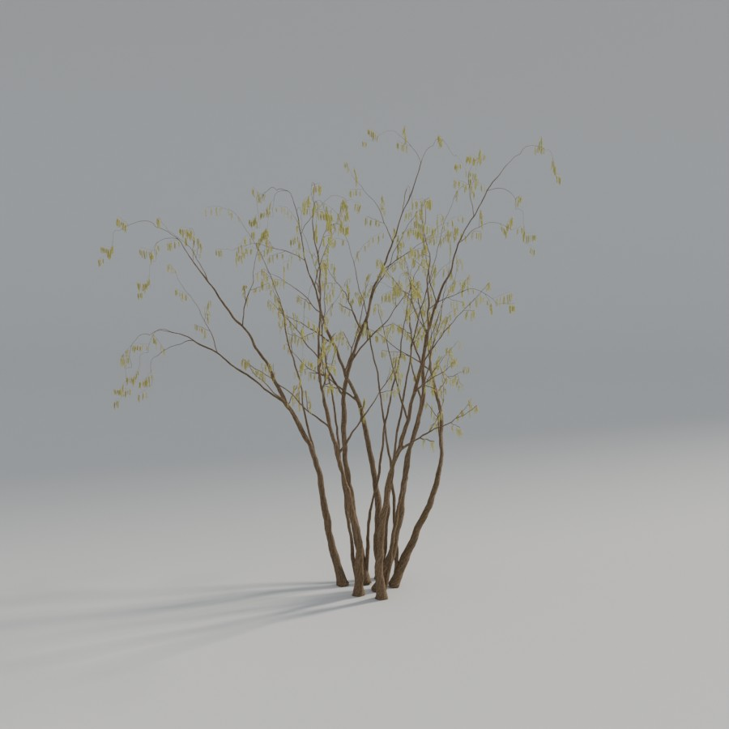 | 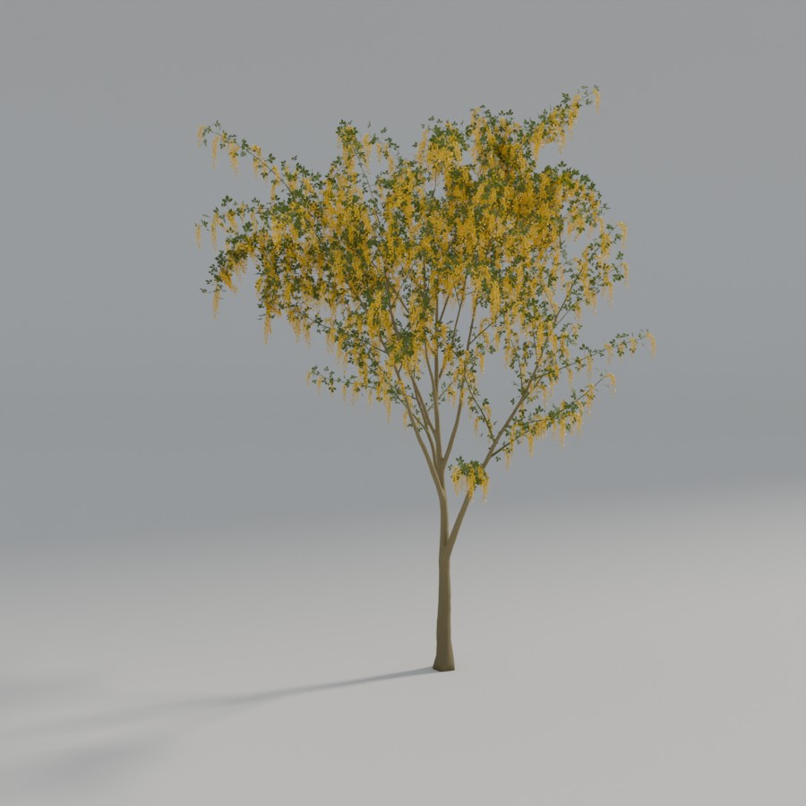 |
| *Lycopodium clavatum* | *Araucaria araucana* | *Corylus avellana* | *Laburnum anagyroides* |

## Install
Needs Blender 5.2 or later. In **Edit > Preferences > Add-ons**, choose
**Install from Disk**, pick `plant_gen.zip` and enable **PlantGen**. The zip is about
52 MB, nearly all of it the eight bundled presets. Build it from a clone with
`python tools/build_zip.py`.

## Install (development)
Point Blender at the repo instead of a copy, with a directory **junction**
from a Blender add-ons path to this repo's `plant_gen/` folder:
```powershell
New-Item -ItemType Junction -Path "<blender-addons-path>\plant_gen" -Target "<repo>\plant_gen"
```
Then enable **PlantGen** under **Edit > Preferences > Add-ons**. After a code
change, disable and re-enable the add-on: a blind Reload Scripts can leave
registration inconsistent.

## Use
Everything is in the 3D Viewport **N-panel > PlantGen** tab, in workflow order:
- **Plant Generator** -- **Add Plant**, species presets, Seed, Day, the calendar,
  Lifespan, the growth timelapse (Grow Over Timeline) and Variations.
- **Components** -- the branching levels and the leaf / bract / flower / bud /
  fruit components placed on them, each with its masks and traits.
- **Physiology** -- tropisms, timing, stiffness, pruning, surface and Weld, light,
  obstacles, effectors, senescence, the rig and its export, and wind.
- **Mapping & Classification** -- every map on a parameter, classes and custom
  attributes.
- **Texturing** -- the materials list, UVs and vertex-colour views.
- **Leaf Generator** and **Flower Generator** -- build the assets the components
  instance.

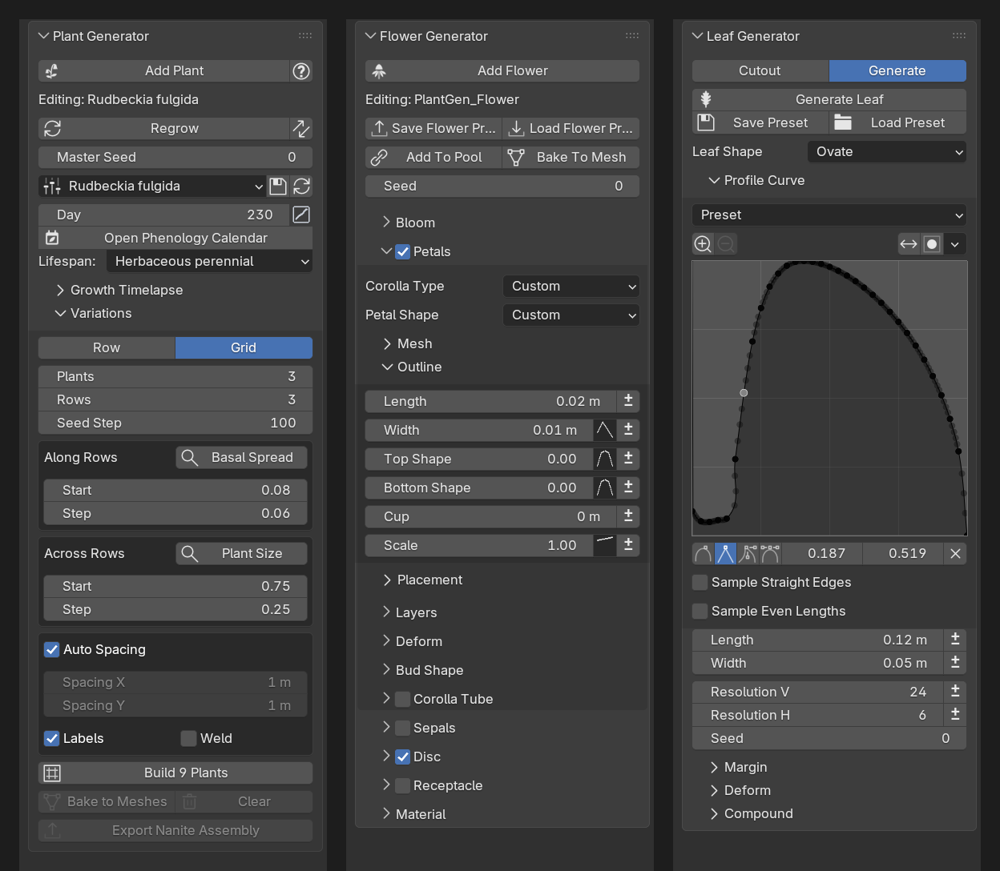

**Debug Tools** (checks, debug views, parameter sweeps, diagnostics) is off by
default: turn it on in the add-on's preferences. The manual opens from Plant
Generator's help button.

## Unreal Engine
PlantGen exports to Unreal Engine 5.7 or later as binary USD (`.usdc`) with a
Dynamic Wind file (`_wind.json`) per plant: Build Rig, then Export Nanite Assembly
in the Rig fold. A plant's variations export as one file, from Variations, so they
share their meshes, materials and textures. Export Rig writes a plain skinned mesh
to FBX or `.usdc`; the Unreal route tested is USD. The manual's Nanite Assembly
how-to covers the import.

## Known limits
- **Thin-wall leaves don't reach Unreal:** the export writes plain opaque materials,
  so Blender's leaf translucency is lost unless you build a Two Sided Foliage
  material in Unreal.
- **Rare weld seams:** a few crowded junctions leave small open seams on the stem
  mesh, mostly with the compound umbels. No bundled preset has them.
- **Long rebuilds:** a setting that multiplies the plant (flowers at every node of a
  grass, pleiochasial stems) can take many minutes to regrow and weld.
- **Trees:** PlantGen is built for perennials. Trees work, but they are heavy:
  Laburnum is 4.17 M vertices with its instances realized.

## Development
- **Layout:** `plant_gen/growth/` (the simulation and the asset models) and
  `plant_gen/geometry/` (stem mesher, rig layout, leaf collision) are pure
  Python with no `bpy`; `plant_gen/blender/` is the Blender side (bridge,
  Geometry Nodes builders, properties, operators, panels).
- **Tests:** headless, from the repo root, e.g.
  `python -m plant_gen.tests.structural` -- structural checks, inflorescence /
  physics / architecture goldens, preset round-trip, maps, the stem mesher and
  more under [`plant_gen/tests/`](plant_gen/tests/). Every change must keep
  them byte-identical unless it means to move them.
- **Lint:** [Ruff](https://docs.astral.sh/ruff/), config in `pyproject.toml`:
  `python -m ruff check plant_gen tools`.
- **Before a release:** `python tools/stress_sweep.py` grows, welds, rigs and
  exports each preset through hundreds of setting combinations in background
  Blenders and flags crashes, open meshes and failed exports.
- **Docs:** `python tools/build_docs.py` regenerates the documentation site.
- **Editor typing:** `fake-bpy-module` (see the dev extras in `pyproject.toml`).

## License
PlantGen is free software under the GNU General Public License, version 3 or
later: see [`LICENSE`](LICENSE). Copyright (C) 2026 Daan Jansen.
